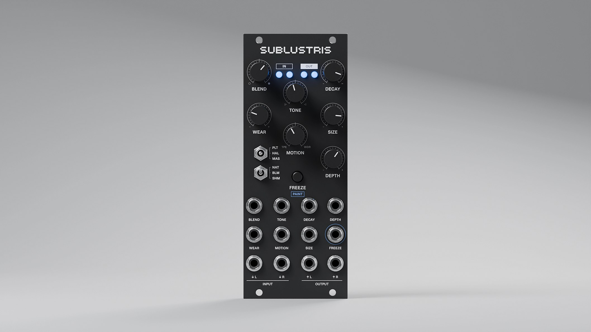

# Sublustris Versio

**A huge, warm, lush reverb for the Noise Engineering Versio.** I wanted a reverb I could live inside: tails long enough for dub techno, ambient and dark ambient, a freeze I can play over, and an endless setting that holds a chord for as long as I want without running away or turning metallic. It's free firmware for the Versio Eurorack module, and the same sound runs as an AU/VST3 plugin on macOS.

*Sublustris*: Latin, "dimly lit, faintly glowing", the half-light of a clouded night. By [Jesse Bauer](https://jessebauer.xyz). Not affiliated with or endorsed by Noise Engineering. A sibling to [Resilio Versio](https://github.com/jeffebauer/resilio-versio).

## What it is

Sublustris is alternative firmware for the [Versio](https://noiseengineering.us/products/versio), Noise Engineering's open Eurorack platform. It replaces the module's firmware entirely, and you can go back just as easily with Noise Engineering's own Firmware Swap web app.

It's built for long, deep tails, and for playing over them:

- Turn DECAY past about 3 o'clock and the tail never ends. While you play it follows you at the level of the tail just below, so crossing into endless doesn't jump; when you stop, it holds the chord, its notes staying notes instead of dissolving into haze.
- Tap the button (or send a gate) to freeze the tail into a still pad, then play over it. Hold the button while frozen to paint a little of what you're playing into the pad.
- SPACE picks the room: PLATE, a dense plate with a quick attack; HALL, a big room tuned against the Valhalla rooms and plates I play; or CANYON, long lines and mass like a space with no roof, which swells in with each sound and grows into a boundless wash.
- Let it age with WEAR: tape saturation driven hard at the top, a bucket-brigade delay's breathing, bit grit and a soft hiss deepen together over a warm, desk-like colour. It only colours the reverb; your dry signal isn't touched.
- MOTION moves the tail both ways from noon: left is a cassette on a tired deck (wow, flutter, crinkle and dropouts, deeper the further you go), right is an old AM radio, its narrow band and a slow notch wandering through the tail.
- ONSET picks how each sound enters: at once (NATURAL), swelling in (BLOOM), or with an octave on top (SHIMMER).

There are seven knobs, each with a CV input, plus two switches, a button and a gate. The [manual](docs/minisite/content/manual.md) covers every control, and [`SPEC.md` §3](SPEC.md) has the details.

> **Status:** in development, not yet released. The firmware runs on real hardware and I play it at the rack, but the sound still changes from version to version. There are no public downloads yet. CANYON was called MASSIVE until 1 November 2026; sets and presets saved with MASSIVE still open on it.

## How it was made

I designed Sublustris by ear. I'm a designer, and I set the musical goals and made every sound decision. Claude (Anthropic's AI) wrote the DSP, the firmware and the tools. The plate follows Dattorro's design and the hall and canyon spaces are feedback delay networks after Jot. Each was refined against the literature and against recordings of the reverbs I use.

Nothing changed in the sound until I'd heard it: every option went onto a listening page next to the version before it, usually level-matched, and I picked. More than thirty decisions are written up with their reasons in [`docs/adr/`](docs/adr/), and every version's change is in the changelog at the top of [`SPEC.md`](SPEC.md).

## For builders

One DSP core with no platform code, and three hosts: an offline renderer (WAV in, WAV out), the JUCE plugin and the Versio firmware (libDaisy). They all read the same parameter table, so a setting in the plugin sounds the same on the module. The firmware fits in the Versio's 128 KB of internal flash, with its busiest moments timed on the module itself.

- The specification is [`SPEC.md`](SPEC.md), the vocabulary is in [`CONTEXT.md`](CONTEXT.md), and the decisions are in [`docs/adr/`](docs/adr/).
- Firmware variants, CPU runs and the flash budget are in [`firmware/README.md`](firmware/README.md).
- The build commands are in [`CLAUDE.md`](CLAUDE.md), under "Commands".

## Licence

- **Code, tools and docs:** MIT, see [`LICENSE`](LICENSE).
- **Plugin binaries:** AGPLv3. The plugin is built on [JUCE](https://juce.com), used under its AGPLv3 licence (full text in [`LICENSES/AGPL-3.0.txt`](LICENSES/AGPL-3.0.txt)).
- **Firmware:** my MIT code with libDaisy (MIT), the STM32 HAL (BSD-3-Clause) and CMSIS (Apache-2.0). No JUCE, and no Noise Engineering code.
- Third-party notices: [`NOTICE`](NOTICE).

## Acknowledgements

- Reverb design: J. Dattorro ("Effect Design, Part 1"), J.-M. Jot and A. Chaigne (feedback delay networks), D. Griesinger and the Lexicon 224 (modulated delays against metallic ringing), and S. Schlecht and V. Välimäki's work on modulated FDNs. Full references are in [`docs/research/`](docs/research/).
- The reverbs whose character shaped it: Valhalla Supermassive and VintageVerb, the Meris Mercury7, the Eventide Blackhole, the Vongon Ultrasheer and the Alesis Midiverb.
- [Electro-Smith](https://electro-smith.com) for libDaisy, and [Noise Engineering](https://noiseengineering.us) for the open Versio platform.
- Where infinite reverb began: Brian Eno and Robert Fripp's two-Revox tape loops, and the dub techno and ambient records Sublustris is made for.

## Trademarks

Versio is a trademark of Noise Engineering. VST is a registered trademark of Steinberg Media Technologies GmbH. Audio Units is a trademark of Apple Inc. Valhalla, Meris, Eventide, Vongon, Alesis and Lexicon are trademarks of their owners; their names are used only to describe influences.
